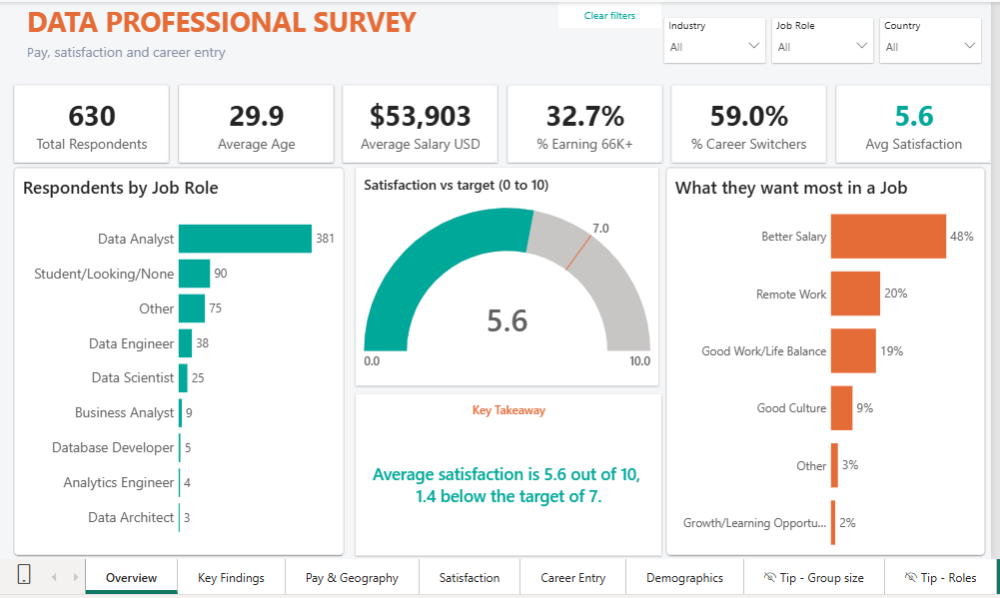
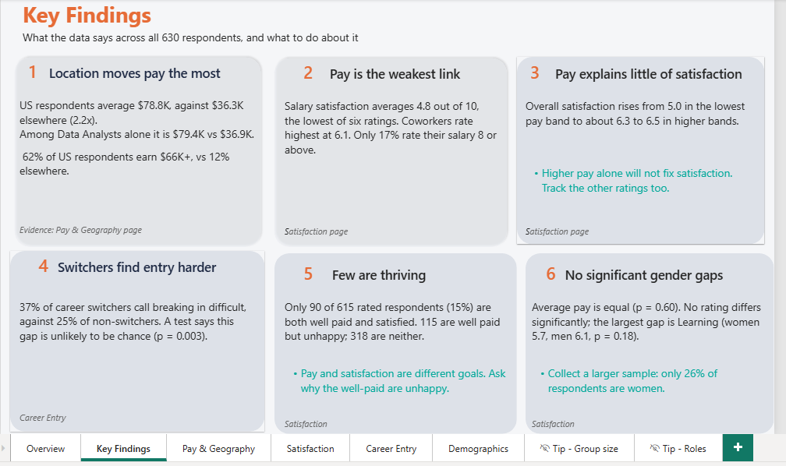
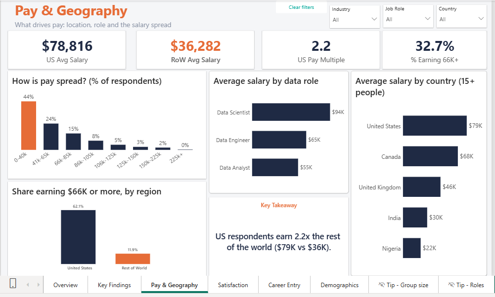
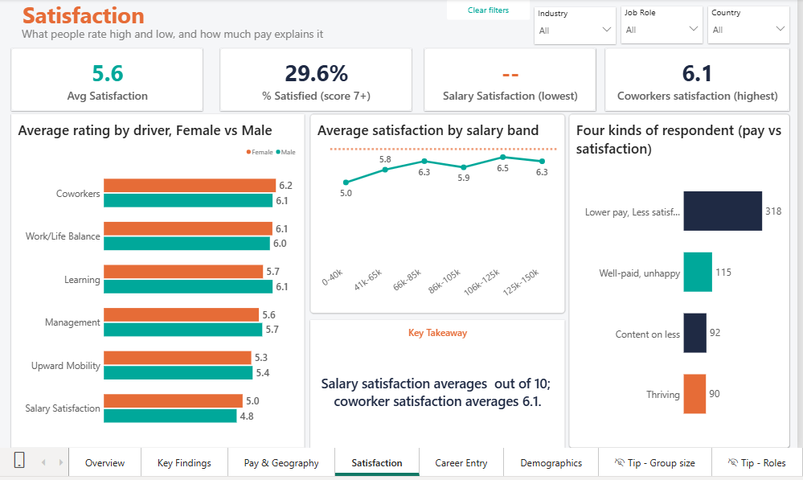
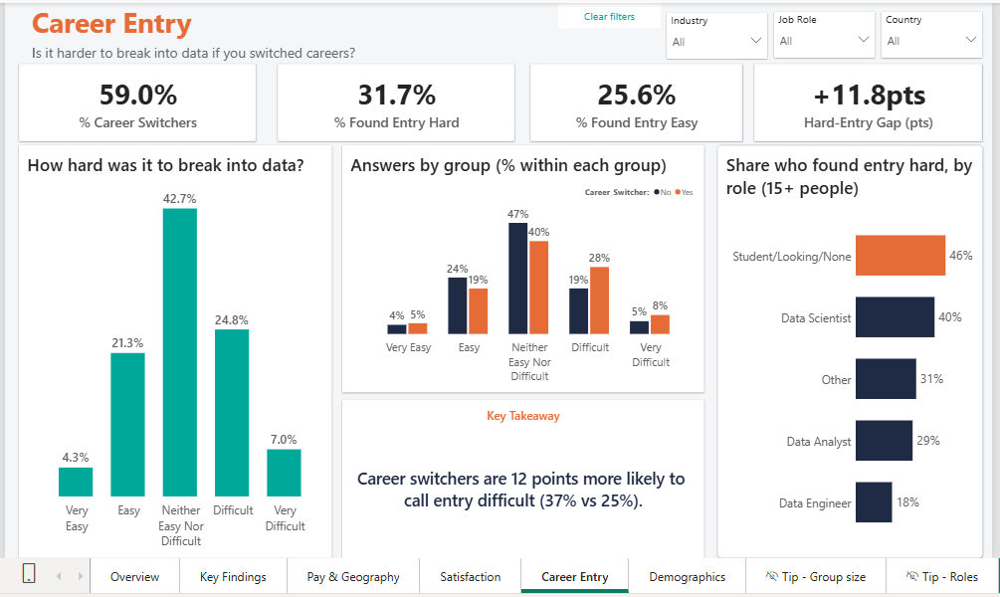
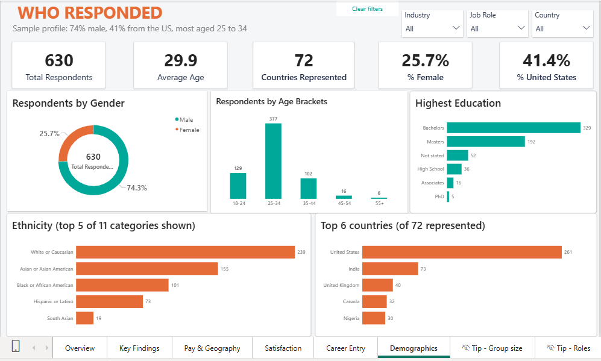

# Data Professional Survey Dashboard (Power BI)

**What do data professionals earn, how satisfied are they, and how hard is it to break into the field?**
A six-page Power BI analysis of 630 survey responses, taken from raw data to published insights.



---

## Summary

I analysed a publicly shared survey of 630 people who work in, or are trying to enter, data. I cleaned the data in Power Query, modelled it in Power BI, wrote the measures in DAX, and built a report that answers four business questions and ends with six findings.

**Headline results**

- **Where you work moves pay the most.** US respondents average **$78.8K** against **$36.3K** elsewhere (2.2x).
- **Pay is the weakest link.** Salary satisfaction averages **4.8 out of 10**, the lowest of six ratings. Overall satisfaction is **5.6**, 1.4 below the target of 7.
- **Career switchers find entry harder:** **37%** call it difficult, against **25%** of non-switchers.

---

## Business questions

1. **Who answered?** (sample profile)
2. **What drives pay?** (country, role, pay spread)
3. **What are people satisfied and unsatisfied with, and how much does pay explain it?**
4. **Is it harder to break into data if you switched careers?**

---

## Key findings and recommendations

The report's Key Findings page shows each finding with its evidence. The full evidence and a recommendation for each are below.

### 1. Location moves pay the most
US respondents average $78.8K, against $36.3K elsewhere (2.2x). Among Data Analysts alone it is $79.4K vs $36.9K. 62% of US respondents earn $66K+, vs 12% elsewhere.
**Recommendation:** benchmark pay against your own country, not a global average.
*Evidence: Pay & Geography page.*

### 2. Pay is the weakest link
Salary satisfaction averages 4.8 out of 10, the lowest of six ratings. Coworkers rate highest at 6.1. Only 17% rate their salary 8 or above.
**Recommendation:** pay is where employers have the most room to improve.
*Evidence: Satisfaction page.*

### 3. Pay explains little of satisfaction
Overall satisfaction rises from 5.0 in the lowest pay band to about 6.3 to 6.5 in higher bands, but the link is modest.
**Recommendation:** higher pay alone will not fix satisfaction. Track the other ratings too.
*Evidence: Satisfaction page.*

### 4. Switchers find entry harder
37% of career switchers call breaking in difficult, against 25% of non-switchers (a gap of 12 points). Respondents still looking for a data job report the most difficulty (46%).
**Recommendation:** bootcamps and employers should support switchers with portfolios and mentoring.
*Evidence: Career Entry page.*

### 5. Few are thriving
Only 90 of 615 rated respondents (15%) are both well paid and satisfied. 115 are well paid but unhappy; 318 are neither (lower pay, less satisfied). The cutoffs behind these groups are explained under "Definitions and thresholds" below.
**Recommendation:** pay and satisfaction are different goals. Ask why the well-paid are unhappy.
*Evidence: Satisfaction page.*

### 6. No significant gender gaps
Average pay is equal. No rating differs significantly; the largest gap is Learning (women 5.7, men 6.1).
**Recommendation:** collect a larger sample, since only 26% of respondents are women.
*Evidence: Satisfaction page.*

---

## How to read this report

The sample is self-selected (74% male, 41% US, 44% earn under $40K), so the results are a community snapshot, not the whole market. Salary is a band midpoint, so figures are approximate. A rating of 0 is treated as no answer. Groups with fewer than 15 people are hidden. The findings show **associations, not causes**.

### Definitions and thresholds

- **"Well paid"** means a salary band of **$66K or above** (about the top third of respondents, 32.7%). In the data this is `Salary USD >= 75,500`, the midpoint of the $66K-$85K band, because salary is stored as band midpoints.
- **"Satisfied"** means an average rating of **7 or more** across the ratings a person answered (29.6% of rated respondents).
- The **target of 7** on the Overview gauge is my own benchmark, not an official score.
- These cutoffs are **my own choices**; the survey does not define them. Using a satisfaction cutoff of 6 or 8 instead changes the "thriving" share from 15% to 19% or 9% (at the $66K pay cutoff). Across the nine combinations I tested, the thriving group was always a minority (5% to 31%), but the exact counts depend on the cutoffs.
- Because pay is measured in US dollars, the personas largely reflect US vs non-US respondents: 79% of the "well paid" group is in the US, and 30% of US respondents are "thriving" against 3.6% of everyone else. "Well paid" therefore means well paid in dollars, not relative to local pay.

---

## Dashboard walkthrough

| Page | Question it answers | What's on it |
|---|---|---|
| **Overview** | Who answered, and how satisfied are they? | Six KPI cards, satisfaction gauge against a target of 7, respondents by job role, top job priority, live takeaway text |
| **Key Findings** | So what? | Six findings with their evidence (recommendations are in this README) |
| **Pay & Geography** | What drives pay? | Pay-band spread, average salary by country and by data role, US vs rest of world |
| **Satisfaction** | What do people rate high and low? | Ratings by driver and gender, satisfaction by salary band, four respondent types |
| **Career Entry** | Is it harder for career switchers? | Difficulty overall and by group, difficulty by role |
| **Who Responded** | How far can we trust the findings? | Gender, age, education, ethnicity and country profile of the sample |







**Interactivity:** three synced slicers (Industry, Job Role, Country), a Clear filters button, a page navigator, and tooltips showing group size, average salary and satisfaction. On the Overview, hovering over the "Other" job role lists what those respondents typed in. The interactive report is built in Power BI Desktop; this repository includes a PDF export and screenshots of every page (see "How to view" below).

---

## Data

**Source:** the Data Professional Survey dataset shared by Alex the Analyst: [`Power BI - Final Project.xlsx`](https://github.com/AlexTheAnalyst/Power-BI/blob/main/Power%20BI%20-%20Final%20Project.xlsx) in his [Power-BI repository](https://github.com/AlexTheAnalyst/Power-BI). I did not collect the survey. The data preparation, modelling, DAX measures, dashboard design and findings in this repository are my own work.

**Data not included:** the source repository does not state a licence, so I have **not** redistributed the dataset or the Power BI file (which embeds it). To reproduce the analysis, download the file from the link above and apply the steps under "Data preparation" below. The structure that follows describes the cleaned records I worked from (630 rows, 28 columns).

**Structure:** 630 rows (one per respondent) and 28 columns. The file has no names or contact details.

| Group | Columns |
|---|---|
| Identifier | `Unique ID` |
| Pay | `Salary_Range` (band), `Salary (Midppoint USD)` (the band's midpoint) |
| Satisfaction ratings (0 to 10) | `Salary`, `Work/Life Balance`, `Coworkers`, `Management`, `Upward Mobility`, `Learning` |
| Career entry | `Career_Switch`, `Transition_into_Data` |
| Respondent profile | `Gender`, `Age`, `Age Brand`, `Education`, `Ethnicity`, `Country` |
| Work context | `Job Role`, `Industry`, `Favorite Programming Language`, `Priority` |
| Helper and write-in columns | sort keys, and five `.2` columns holding typed "Other" answers |

---

## Data preparation (Power Query)

| Issue found | What I did | Why |
|---|---|---|
| The column `Salary` is a 0 to 10 **satisfaction rating**, not pay | Renamed to `Salary Satisfaction`; renamed the midpoint column to `Salary USD` | Two "salary" fields caused confusion |
| 277 ratings of **0** (111 respondents). The lowest real score is 1, so 0 most likely means "no answer" | Replaced 0 with blank in the six rating columns | Zeros dragged scores down: overall satisfaction moves from 5.25 to **5.60**. This is an assumption, stated openly. |
| Blanks: Country (4), Education (52), Industry (5) | Replaced with "Not stated" | Every chart still adds up to 630 |
| Text problems in `Country` | Trimmed spaces, corrected one country name | A hidden space prevented grouping and mapping |
| Age-group sort numbers were wrong (35 to 44 and 45 to 54 shared a number) | Rebuilt the sort columns for age and salary band | Charts show groups in a sensible order |
| Six rating columns side by side | Unpivoted into a `Drivers` table (3,445 ratings) | One chart can compare all six ratings |
| Typed "Other" answers in five `.2` columns | Kept them, renamed as write-ins | Used in tooltips, not as chart axes |

---

## Data model

```
Survey (630 rows, one per respondent)
   |  Respondent ID  (one to many, single direction)
   v
Drivers (3,445 rows, one per answered rating)

_Measures (measures only, no data)
```


Filters flow from `Survey` to `Drivers`, so a slicer on gender, country or role also filters the ratings.

---

## Selected DAX

**One satisfaction score per respondent** (calculated column): averages only the ratings that person answered.

```dax
Satisfaction Score = CALCULATE ( AVERAGE ( Drivers[Score] ) )
```

**Small-group guard:** hides any average based on fewer than 15 people, because small groups swing too much to be reliable.

```dax
Min N = 15

Avg Salary (Safe) =
IF ( [Total Respondents] >= [Min N], [Avg Salary USD], BLANK () )
```

**Share within a group:** compares groups of different sizes fairly (for example, what share of switchers found entry hard). The sort column is included in `ALL` because the axis is sorted by it.

```dax
% of Group =
DIVIDE (
    [Total Respondents],
    CALCULATE (
        [Total Respondents],
        ALL ( Survey[Transition_into_Data], Survey[Transition_sorting] )
    )
)
```

---

## Where some figures come from

A few numbers in the findings are not shown directly on a report page:

- **Data Analysts, US vs rest of world ($79.4K vs $36.9K):** set the Job Role slicer to Data Analyst on the Pay & Geography page (165 US respondents, 216 elsewhere).
- **17% rate their salary 8 or above:** 93 of the 549 answered salary-satisfaction ratings (16.9%), from the `Drivers` table.
- **Respondents still looking for a data job find entry hardest (46%):** Career Entry page, by-role chart.

**Statistical tests** were calculated outside Power BI ([state the tool you used: Excel / Python]):

- Switchers vs non-switchers finding entry hard: chi-square test, p = 0.003.
- Pay by gender: Welch two-sample t-test, p = 0.60. Largest rating gap (Learning, women 5.7 vs men 6.1): p = 0.18.
- Pay and overall satisfaction: Pearson correlation r = 0.26, a modest link. Salary satisfaction tracks actual pay more closely (r = 0.45); the other five ratings sit between 0.15 and 0.20.

---

## Limitations

- **Self-selected sample:** 74% male, 41% from the US, 44% earn under $40K (many are students or job seekers).
- **Salary is a band midpoint,** so figures are approximate. Medians are coarse for the same reason.
- **A rating of 0 is treated as "no answer".** If 0 is a real score, overall satisfaction would be 5.25.
- **Groups with fewer than 15 people are hidden** in comparisons (for example, Germany, with 14 respondents, does not appear in the country chart).
- **No years of experience or time dimension,** so pay cannot be compared by career stage or over time.
- Some groups are small even above the threshold (for example, 25 Data Scientists).
- **The persona cutoffs ($66K, satisfaction of 7) are my own choices,** and the exact group sizes change if they change (see "Definitions and thresholds").

---

## Skills demonstrated

Power Query data cleaning and unpivoting, data modelling, DAX (calculated columns, measures, filter context, `CALCULATE`, `ALL`), dashboard design and storytelling, interactivity (slicers, tooltips, navigation), and clear statement of limitations.

## What I would do next

- Add years of experience, so pay can be compared by career stage.
- Control for country when comparing roles, since location and role overlap.
- Analyse the typed write-in answers as text.
- Repeat the analysis on a second survey year to see what changed.

---

## How to view

1. Open the PDF export: `dashboard/Data_Career_Survey_Dashboard.pdf` (all six pages).
2. Browse the page screenshots in the `images/` folder, or in the walkthrough above.
3. To rebuild it yourself: download the dataset from the source link, follow "Data preparation" and "Data model", and use the measures under "Selected DAX". The page layouts are described in "Dashboard walkthrough".

The interactive Power BI file is not included because it embeds the survey data (see "Data not included" above).

## Repository structure

```
├── README.md
├── dashboard/
│   └── Data_Career_Survey_Dashboard.pdf
├── data/
│   └── README.md          (source link and column descriptions; no data file)
└── images/
    ├── 01-overview.png
    ├── 02-key-findings.png
    ├── 03-pay-geography.png
    ├── 04-satisfaction.png
    ├── 05-career-entry.png
    ├── 06-who-responded.png
    └── 07-model.png
```

The survey data and the `.pbix` (which embeds it) are not included, because the source states no licence. Download the dataset from the source link in the Data section.

---

## Acknowledgements

Survey dataset: Alex the Analyst. This project is my own independent analysis of that data.

---

**[Your name]** | [LinkedIn] | [Email] | [Portfolio]
